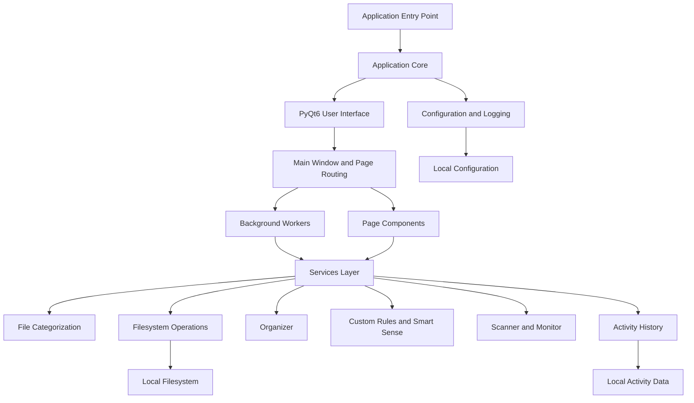
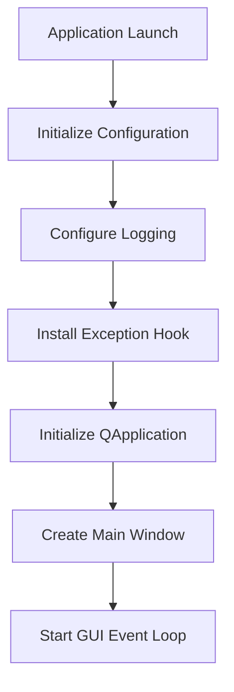
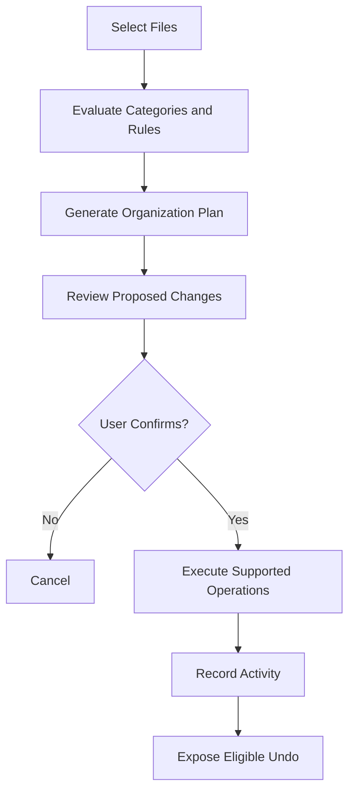

# Smart File Manager (SFM)

[](https://deepwiki.com/kush85252-dotcom/smart-file-manager)
[](https://github.com/kush85252-dotcom/smart-file-manager/releases)
[](LICENSE)
[](https://github.com/kush85252-dotcom/smart-file-manager/stargazers)
[](https://github.com/kush85252-dotcom/smart-file-manager/issues)
[](https://github.com/kush85252-dotcom/smart-file-manager/commits/main)
[](https://www.python.org/)
[](https://www.microsoft.com/windows)

**A local-first desktop file manager and organizer built with Python and PyQt6.**

Smart File Manager brings file browsing, scanning, deterministic categorization, filesystem monitoring, custom organization rules, and file-management workflows into one desktop application.

Designed around transparency and user control, SFM uses deterministic rules instead of AI-driven categorization. Its core functionality operates locally without requiring a cloud backend.

---

## Table of Contents

- [Overview](#overview)
- [Core Philosophy](#core-philosophy)
- [Features](#features)
- [Architecture](#architecture)
- [Application Core](#application-core)
- [Services Layer](#services-layer)
- [Filesystem Operations](#filesystem-operations)
- [Organizer and Undo History](#organizer-and-undo-history)
- [Custom Rules and Smart Sense](#custom-rules-and-smart-sense)
- [Scanning and Live Monitoring](#scanning-and-live-monitoring)
- [User Interface](#user-interface)
- [Background Workers and Threading](#background-workers-and-threading)
- [Configuration and Data Persistence](#configuration-and-data-persistence)
- [Logging and Error Handling](#logging-and-error-handling)
- [Technology Stack](#technology-stack)
- [Installation](#installation)
- [Development and Project Infrastructure](#development-and-project-infrastructure)
- [Security and Data Safety](#security-and-data-safety)
- [Contributing](#contributing)
- [License](#license)
- [Documentation and Links](#documentation-and-links)

---

## Overview

Smart File Manager (SFM) is a Python-based desktop application focused on making file organization more accessible, predictable, and controllable.

Instead of relying on opaque automatic decisions, SFM uses predefined categorization logic, configurable custom rules, and explainable organization suggestions.

The application combines several subsystems:

- File Explorer and directory navigation.
- File categorization and organization.
- Smart Sense recommendation engine.
- Custom Rule Builder.
- Filesystem scanning.
- Optional live filesystem monitoring.
- Favorites and recent folders.
- Persistent activity history.
- Undo support for eligible operations.
- Configurable themes and interface scaling.

**Project goals:**

1. Keep core functionality local.
2. Make file operations understandable.
3. Avoid unnecessary dependencies.
4. Separate application logic from the graphical interface.
5. Give users control over organization decisions.
6. Maintain predictable configuration and data persistence.

---

## Core Philosophy

### Local-First

SFM is designed to perform its core file-management operations directly on the user's computer.

No cloud backend is required for its core workflows.

### Deterministic Organization

File categorization and Smart Sense use deterministic rules and heuristics.

The same supported inputs and configuration produce predictable decisions.

### User Control

Organization operations are planned before execution.

Users can review proposed changes instead of relying on silent automatic file movement.

### Explainability

Smart Sense is designed around understandable rule-based recommendations rather than opaque AI predictions.

### Lightweight Architecture

The project uses Python's standard library wherever practical and keeps external dependencies focused on specific application requirements.

---

## Features

### 1. Smart Sense

Smart Sense provides locally generated, rule-based file-organization suggestions.

Its recommendation logic is implemented separately from the graphical interface.

Key characteristics:

- Deterministic recommendation logic.
- Local processing.
- Rule-based decisions.
- Explainable suggestions.
- Integration with the organization workflow.

Smart Sense is not an AI model and does not require a cloud AI service.

### 2. Custom Rule Builder

The Custom Rule Builder allows users to define their own file-organization conditions.

Supported rule condition types include:

| Condition | Purpose |
|---|---|
| `name_contains` | Match filenames containing specified text |
| `name_starts` | Match filenames beginning with specified text |
| `extension` | Match file extensions |
| `location_glob` | Match directory locations using glob patterns |

The rule subsystem includes:

- Rule validation.
- Schema versioning.
- Rule storage.
- Condition evaluation.
- Rule prioritization.
- Local persistence.

The current implementation defines limits of 500 rules per store and eight conditions per rule.

### 3. File Explorer

The graphical interface provides directory navigation and file inspection.

Features include:

- Directory browsing.
- File listings.
- File information.
- Context menus.
- Supported file previews.
- File opening through system associations.
- Navigation between application pages.

### 4. File Categorization

SFM categorizes supported files using extension-based mappings.

| Category | Examples |
|---|---|
| Documents | PDF, DOCX, TXT |
| Images | PNG, JPG, WEBP |
| Videos | MP4, MKV, AVI |
| Audio | MP3, WAV, FLAC |
| Archives | ZIP, 7Z, RAR |
| Applications | EXE, MSI |
| Android packages | APK |
| Scripts | BAT, PS1, SH |
| Code | PY, CPP, JS, HTML |

Categorization logic is handled by the services layer rather than being embedded directly into individual UI components.

### 5. Filesystem Scanning

SFM provides two scanning modes:

**Fast Scan**
- Designed for everyday directory summaries.
- Uses an entry limit.
- Supports hidden-file filtering.
- Reports when results have been truncated.

**Full Scan**
- Provides a more comprehensive directory traversal.
- Supports recursive folder scanning.
- Uses the same underlying traversal architecture.

The scanner includes protections against symbolic-link loops and problematic cloud-placeholder traversal.

### 6. Live Monitoring

SFM can monitor filesystem changes using Watchdog.

Monitoring is optional and can be enabled or disabled.

It is separated from the graphical presentation layer, allowing filesystem events to be handled independently of the main UI.

### 7. Favorites and Recent Folders

SFM provides folder-list utilities for managing:

- Favorite directories.
- Recently accessed folders.
- Recent-folder limits.
- Persistent folder references.

### 8. Themes and Accessibility

The interface supports:

- Dark theme.
- Light theme.
- Adjustable UI scaling.
- Centralized stylesheet definitions.
- Accessibility considerations documented in `ACCESSIBILITY.md`.

### 9. Activity History and Undo

Eligible filesystem operations can be tracked through persistent activity history.

The application provides undo functionality for supported operations.

Undo availability depends on the operation and its recorded information.

---

## Architecture

SFM follows a layered architecture that separates application initialization, business logic, and graphical presentation.

### High-Level Architecture



### Architectural Layers

| Layer | Responsibility |
|---|---|
| Application Entry | Starts the application |
| Application Core | Initializes configuration, logging, and runtime |
| Services | Handles non-UI application logic |
| Presentation | Provides the PyQt6 graphical interface |
| Background Workers | Executes long-running tasks outside the GUI thread |
| Local Persistence | Stores settings, rules, and activity information |

### Design Principles

- Separation of concerns.
- Reusable service modules.
- Independent filesystem logic.
- Non-blocking GUI operations.
- Local persistence.
- Predictable organization behavior.

For the detailed implementation and source references, see the [DeepWiki Architecture Documentation](https://deepwiki.com/kush85252-dotcom/smart-file-manager).

---

## Application Core

The application core establishes the runtime environment.

Its responsibilities include:

- Application startup.
- Configuration initialization.
- Logging initialization.
- Global exception handling.
- Main window initialization.
- Shared presentation utilities.

The primary startup implementation is located in:

`smart_file_manager/app.py`

The `run()` function coordinates initialization and launches the PyQt6 application event loop.

### Startup Sequence



Shared utility functions are implemented in `smart_file_manager/utils.py`.

Examples include:

- `format_size()`: Formats file sizes into readable units.
- `modified_date()`: Formats filesystem modification timestamps.

---

## Services Layer

The services layer is located in:

`smart_file_manager/services/`

It contains the application's core non-UI functionality.

This separation keeps filesystem operations, categorization, organization logic, and background scanning independent of the graphical interface.

### Major Service Modules

| Module | Responsibility |
|---|---|
| `organizer.py` | Organization planning and execution |
| `file_operations.py` | Filesystem primitives |
| `custom_rules.py` | Custom rule validation and storage |
| `smart_sense.py` | Deterministic organization suggestions |
| `scanner.py` | Directory scanning |
| `monitor.py` | Filesystem monitoring |
| `activity_history.py` | Persistent operation history |
| `folder_lists.py` | Favorites and recent folders |
| `json_store.py` | JSON persistence utilities |

The services layer is designed to keep business logic separate from PyQt6 widgets.

---

## Filesystem Operations

The filesystem operation subsystem provides the underlying filesystem utilities.

Implementation:

`smart_file_manager/services/file_operations.py`

Its responsibilities include:

- Opening files and directories.
- Renaming filesystem paths.
- Detecting hidden files.
- Moving files.
- Native recycle-bin or trash integration.
- Path handling.
- Safe destination handling.

### Platform-Aware Operations

The application uses native system mechanisms where appropriate.

Examples include:

- Windows: `os.startfile()`
- macOS: `open`
- Linux: `xdg-open`

### Safe Move Handling

The filesystem subsystem includes atomic move helpers and no-overwrite behavior.

This helps prevent accidental replacement of existing destination files.

---

## Organizer and Undo History

The organizer subsystem is responsible for generating and executing organization plans.

Implementation:

- `smart_file_manager/services/organizer.py`
- `smart_file_manager/services/activity_history.py`

### Organization Planning

SFM generates structured plans before performing filesystem modifications.

The `PlanEntry` data structure represents individual planned operations.

It includes information such as:

- Source path.
- Destination folder.
- Final destination.
- Explanation or reason.
- Associated rule identifiers.
- Warnings.
- Issues.

The `build_organize_plan()` function generates organization plans using the configured categorization and rule logic.

### Activity History

The activity-history subsystem records supported operations and provides the information needed for eligible undo workflows.

History is persisted locally.

### General Workflow



Undo is not guaranteed for every possible filesystem operation.

---

## Custom Rules and Smart Sense

The rule engine is implemented separately from the UI.

Relevant modules:

- `smart_file_manager/services/custom_rules.py`
- `smart_file_manager/services/smart_sense.py`

### Rule Validation

Custom rules use a versioned schema.

The indexed implementation defines:

- Rule schema version: `1`
- Maximum rules: `500`
- Maximum conditions per rule: `8`

Invalid rule structures and unsupported condition types are subject to validation.

### Smart Sense

Smart Sense uses local heuristics to generate organization suggestions.

Its operation is based on supported file information and configured deterministic logic.

It does not require:

- Cloud AI APIs.
- Local language models.
- Remote recommendation services.

---

## Scanning and Live Monitoring

The scanning subsystem is implemented in:

`smart_file_manager/services/scanner.py`

### Scanner

The scanner provides read-only directory traversal.

Its fast and full modes use a shared iterative traversal implementation.

The scanning architecture includes handling for:

- Hidden files.
- Symbolic links.
- Cloud placeholders.
- Large directory structures.
- Scan limits.
- Progress reporting.

The documented fast-scan entry limit is 100,000 entries.

### Monitor

Implementation:

`smart_file_manager/services/monitor.py`

The monitoring subsystem uses Watchdog to observe filesystem changes when monitoring is enabled.

### Folder Lists

Implementation:

`smart_file_manager/services/folder_lists.py`

This module handles favorites and recent-folder data independently of the UI.

---

## User Interface

The presentation layer is implemented using PyQt6.

Main package:

`smart_file_manager/ui/`

### Main Window

The main application window is implemented through the `SFM_Lite` class.

It inherits from `QMainWindow` and coordinates:

- Application navigation.
- Page initialization.
- Shared UI state.
- Integration with core services.
- Dialogs and application-level interactions.

### Page Routing

A central stacked widget manages navigation between application pages.

This keeps page transitions within the main application window.

### Page Components

The UI uses modular page components rather than placing every feature into one enormous window implementation.

### Styling

The stylesheet implementation is located in:

`smart_file_manager/ui/styles.py`

It provides centralized dark and light theme definitions.

The UI also supports configurable scaling.

---

## Background Workers and Threading

SFM uses Qt background workers for long-running operations.

Implementation:

`smart_file_manager/ui/workers.py`

### ScanWorker

The `ScanWorker` class inherits from `QThread`.

It moves directory-scanning work away from the main GUI event loop.

This helps maintain interface responsiveness during lengthy scans.

### Thread Communication

The worker uses Qt signals to communicate with the main application.

| Signal | Purpose |
|---|---|
| `progress` | Reports scanning progress |
| `scan_finished` | Returns completed scan results |
| `scan_failed` | Reports scanning errors |

The implementation also includes cooperative cancellation and exception handling at worker boundaries.

---

## Configuration and Data Persistence

SFM stores application configuration locally.

Relevant modules:

- `smart_file_manager/config.py`
- `smart_file_manager/services/json_store.py`

### AppConfig

The `AppConfig` class provides the central configuration interface.

Its responsibilities include:

- Loading settings.
- Validating configuration.
- Updating preferences.
- Saving settings.
- Handling older settings schemas.

### Settings Schema

The indexed implementation identifies settings schema version `2`.

It includes settings for:

- Startup preferences.
- Hidden-file visibility.
- Recycle-bin behavior.
- Activity logging.
- UI scaling.
- Favorites.
- Recent folders.

### Configuration Locations

| Platform | Configuration location |
|---|---|
| Windows | `%APPDATA%\SmartFileManager\` |
| macOS | `~/Library/Application Support/SmartFileManager/` |
| Linux | `~/.config/smart-file-manager/` |

The application also supports an `SFM_SETTINGS_PATH` environment variable for configuration-path overrides.

### Atomic JSON Persistence

The JSON storage subsystem includes safeguards against incomplete writes.

Its documented write process includes:

1. Acquiring an exclusive file lock.
2. Creating a temporary file.
3. Writing serialized JSON.
4. Flushing and synchronizing data.
5. Atomically replacing the target file.

### Configuration Recovery

The configuration subsystem includes:

- Type validation.
- Range validation.
- Path-list sanitation.
- Duplicate-path handling.
- Settings migration.
- Malformed-settings backup.

When malformed configuration is encountered, the application can preserve the problematic file before falling back to default settings.

---

## Logging and Error Handling

Implementation:

`smart_file_manager/logging_config.py`

SFM includes centralized application logging and exception handling.

### Logging

The logging subsystem supports:

- Console logging.
- Optional activity-file logging.
- Rotating log files.
- Configurable logging behavior.

The indexed implementation documents a maximum log size of 512 KB and two backup files.

### Exception Handling

The application installs a global exception hook to capture unhandled exceptions.

It records diagnostic information while allowing normal handling of keyboard interrupts.

Logging failures are also handled gracefully so that a logging problem does not unnecessarily terminate the application.

---

## Technology Stack

| Technology | Purpose |
|---|---|
| Python | Application logic |
| PyQt6 | Desktop GUI |
| pathlib | Filesystem path handling |
| Watchdog | Filesystem event monitoring |
| JSON | Local configuration and rule persistence |
| Qt Signals | Worker-to-UI communication |
| QThread | Background execution |
| GitHub Actions | Automated checks and builds |
| CodeQL | Security analysis |
| Dependabot | Dependency update management |

---

## Installation

### Requirements

- Windows 10 or newer.
- Python.
- Git.
- Dependencies listed in `requirements.txt`.

### Clone the Repository

```powershell
git clone https://github.com/kush85252-dotcom/smart-file-manager.git
cd smart-file-manager
```

### Create a Virtual Environment

```powershell
python -m venv .venv
```

### Activate It

```powershell
.\.venv\Scripts\Activate.ps1
```

### Install Dependencies

```powershell
python -m pip install -r requirements.txt
```

### Run

```powershell
python -m smart_file_manager
```

If activation is unavailable, use the virtual environment's Python executable directly.

### Download a Release

Prebuilt releases, when available, can be found here:

[GitHub Releases](https://github.com/kush85252-dotcom/smart-file-manager/releases)

---

## Development and Project Infrastructure

SFM uses GitHub-based development infrastructure.

The indexed repository documentation identifies the following automation components:

### Continuous Integration

GitHub Actions workflows provide automated checks for code changes.

The documented workflow includes:

- Python checks.
- Push-triggered validation.
- Pull-request validation.
- Manual workflow execution.

### Windows Builds

A dedicated Windows build workflow handles standalone application build processes.

### Security Analysis

The repository includes CodeQL workflow configuration for automated code analysis.

### Dependency Management

Dependabot configuration helps track dependency updates.

### Repository Governance

Project governance is documented through:

- `CONTRIBUTING.md`
- `CODE_OF_CONDUCT.md`
- `SECURITY.md`
- `LICENSE`

---

## Project Status

Smart File Manager is actively developed.

**Documented release milestone: v2.2.0**

Major development milestones:

| Version | Major changes |
|---|---|
| v1.5.0 | Redesigned PyQt6 interface, explorer, and context menus |
| v2.0.0 | Persistent settings, themes, scaling, operation previews, undo controls |
| v2.1.0 | Live monitoring, favorites, recent folders, scanning improvements |
| v2.2.0 | Smart Sense and Custom Rule Builder |

For detailed release history, see [changelog.md](changelog.md).

---

## Security and Data Safety

SFM is designed around user-controlled file operations.

Important considerations:

- Review proposed organization changes.
- Confirm operations before execution.
- Keep backups of important files.
- Avoid operating on unfamiliar directories without reviewing their contents.
- Understand that not all operations support undo.
- Report security vulnerabilities through the project's security reporting process.

---

## Contributing

Contributions and practical suggestions are welcome.

Before contributing:

1. Read `CONTRIBUTING.md`.
2. Check existing issues.
3. Explain the proposed change.
4. Include reproducible steps for bug reports.
5. Keep dependencies justified.
6. Preserve the local-first architecture.

New dependencies and major architectural changes should be discussed before implementation.

Contributions should respect the project's privacy and user-control principles.

---

## License

Smart File Manager is licensed under the MIT License.

See [LICENSE](LICENSE) for the complete license text.

---

## Documentation and Links

| Resource | Link |
|---|---|
| Source Code | [GitHub Repository](https://github.com/kush85252-dotcom/smart-file-manager) |
| Technical Documentation | [DeepWiki](https://deepwiki.com/kush85252-dotcom/smart-file-manager) |
| Releases | [GitHub Releases](https://github.com/kush85252-dotcom/smart-file-manager/releases) |
| Issues | [GitHub Issues](https://github.com/kush85252-dotcom/smart-file-manager/issues) |
| Contributions | [CONTRIBUTING.md](CONTRIBUTING.md) |
| Security | [SECURITY.md](SECURITY.md) |
| Accessibility | [ACCESSIBILITY.md](ACCESSIBILITY.md) |
| Changelog | [changelog.md](changelog.md) |
| License | [LICENSE](LICENSE) |

---

**Smart File Manager**

*Predictable file organization. Local-first by design. User-controlled by default.*
